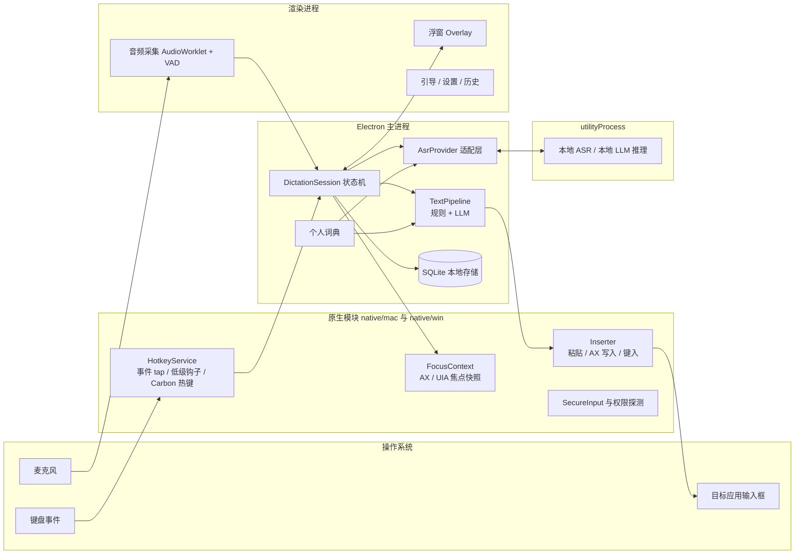
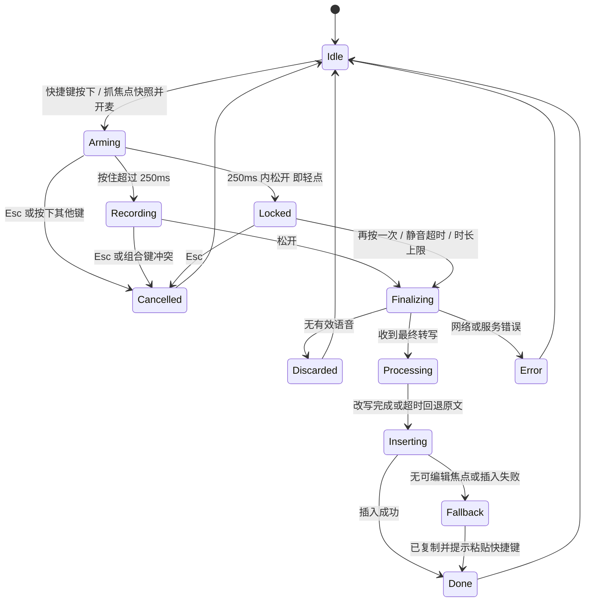

# 语音输入桌面端技术选型报告

> 作者：dogeheng ｜ 日期：2026-10-24 ｜ 状态：第一版（候选方案对比） ｜ 适用目录：`01-voice-input-desktop`

> **更新说明（第二版）**：评审后定为“只做 macOS、Tauri 2 + Rust、OpenRouter 云端 + sherpa-onnx 本地融合识别”。本文中关于 Electron、豆包/OpenAI 实时接口、跨平台原生模块的推荐已被 [第二版定稿](tech-selection-v2.md) 取代；各节点的候选方案对比仍可作为参考。

本报告把产品拆成十个关键节点，每个节点给出三到四个候选方案，从**美观、速度、稳定性、鲁棒性、安全性、易用性**六个角度比较，再给出推荐方案、初步设计和实现时要守住的约束。第 14 节给出里程碑、目录结构和核心接口，后续实现可以直接以此开工。所有延迟目标都是设计目标值，需要在 M0 技术验证阶段实测校准。

---

## 1. 推荐组合一览

推荐方案的核心判断有六条。第一，**外壳用 Electron（TypeScript + React），把所有“贴近操作系统”的能力下沉到各平台的原生模块**，包括键盘钩子、焦点读取、文本插入、剪贴板和安全输入检测。这些能力本来就无法跨平台抽象，Electron 只负责编排和界面。第二，**识别走“云端流式为主、本地模型兜底”的 Provider 抽象层**，中国大陆和海外分别选择默认服务商。第三，**交互默认“按住说 + 轻点锁定”的混合模式**，用不抢焦点的浮窗、提示音和菜单栏图标三重反馈状态。第四，**文本处理分层**：先用 ASR 自带的标点、数字规整和顺滑，再走确定性规则，最后由 LLM 轻度改写；LLM 设硬超时，超时就插入原文。第五，**插入采用级联降级**：在按键按下的瞬间锁定目标，主路径用剪贴板粘贴并恢复剪贴板，白名单应用用辅助功能 API 直接写入，找不到输入框时把文本留在浮窗并复制。第六，**隐私默认保守**：只在按键期间录音，音频默认不落盘，文本历史本地加密并可一键关闭，读取上下文单独设开关。

| 关键节点 | 推荐方案 | 主要备选 | 关键理由 |
| --- | --- | --- | --- |
| 桌面框架 | Electron + 自研 N-API 原生模块 | Tauri 2；纯原生 Swift/C# | UI 迭代快、跨平台渲染一致；系统能力交给原生层 |
| Onboarding | 线性向导 + 实时权限检测 + 内置练习框 | 渐进式按需授权；单页清单 | 第一次 Try 必须在 100% 可插入的环境里成功 |
| 快捷键交互 | 按住说 / 轻点锁定 / Esc 取消的混合模式 | 纯按住说；纯切换；VAD 自动结束 | 同时覆盖短句精确和长段免手持 |
| 快捷键捕获 | macOS CGEventTap + Carbon 热键双通道；Windows 低级键盘钩子 | uiohook-napi；Electron globalShortcut | 需要 keyup 和纯修饰键，还要在安全输入模式下不失效 |
| 音频与 VAD | 渲染进程 AudioWorklet 采集（MVP）→ 原生采集；Silero VAD | TEN VAD；WebRTC VAD；服务端判停 | 开发快；VAD 准确且延迟低 |
| 语音识别 | 大陆：豆包流式 2.0；海外：OpenAI gpt-live-transcribe；本地：SenseVoice（sherpa-onnx） | 百炼 qwen-audio-3.1；Deepgram Nova-3；Apple SpeechAnalyzer | 中英混说、热词、首字延迟都要兼顾 |
| 个人词典 | 识别前热词注入 + 识别后确定性替换 | LLM 上下文注入；从修改中自动学习 | 识别错的词改写阶段救不回来 |
| 文本处理 | ASR 内置 + 规则 + 云端小模型轻度改写（硬超时） | 端侧 LLM；纯规则 | 质量和延迟的平衡点 |
| 文本插入 | 剪贴板粘贴（保存/恢复）为主，AX/UIA 直写为辅，浮窗兜底 | 模拟逐字键入；系统输入法 | 兼容面最广，且失败可感知、可补救 |
| 隐私与存储 | 只按键时录音；音频不落盘；文本历史本地加密 30 天 | 零保存；保存音频；云同步 | 默认可信，进阶可选 |

---

## 2. 整体架构与关键时序

### 2.1 分层架构



进程职责划分如下。**主进程**持有唯一的会话状态机 `DictationSession`，负责调度各模块，不做任何重计算。**原生模块**以 N-API 插件形式加载进主进程。事件 tap 必须跑在独立线程的 CFRunLoop 上，回调必须极快返回，否则系统会以超时为由禁用 tap[11]。**utilityProcess** 承担本地模型推理，避免阻塞主进程。**渲染进程**分两类：一个常驻的隐藏窗口负责音频采集（`backgroundThrottling: false`），以及浮窗、设置、引导等可见窗口。

### 2.2 一次听写的关键时序

一次完整的听写按以下顺序发生，每一步都对应一个可埋点的时间戳。

1. **t0 快捷键按下**：原生层同步抓取焦点快照，内容包括前台应用 PID 和 bundleId、窗口、焦点元素的角色、是否为密码框、选区。抓取必须在浮窗出现**之前**完成，否则浮窗哪怕抢到一帧焦点，目标就会变成自己[6]。
2. **t1 开麦**：打开麦克风，同时用已预热的连接开始推流。连接尚未就绪时，音频先写进本地缓冲，连上后补发。
3. **t2 浮窗出现**：以 `showInactive` 显示“聆听中”，不抢焦点。
4. **t3 首个中间结果**：流式识别的中间结果只在浮窗里滚动显示，**不写入目标应用**。
5. **t4 松开**：发送结束包，等待最终结果。
6. **t5 最终转写**：进入文本流水线，规则处理后交给 LLM，LLM 有硬超时。
7. **t6 插入**：先校验焦点仍是 t0 的目标，再按级联策略插入，然后回读验证。
8. **t7 收尾**：写历史，浮窗显示“已插入”后约 0.8 秒收起，或显示“已复制”并提示粘贴快捷键。

### 2.3 端到端延迟预算

Wispr Flow 公开的目标是：停止说话后 700 ms 内完成转写和 LLM 格式化，其中 ASR、LLM、网络各占 200 ms 以内[1]。本产品沿用这一量级作为设计目标。

| 阶段 | 目标 P50 | 目标 P90 | 主要手段 |
| --- | --- | --- | --- |
| 按键 → 开始采集（内置麦克风） | ≤ 50 ms | ≤ 100 ms | 预热 AudioContext；按下即开麦 |
| 按键 → 浮窗可见 | ≤ 80 ms | ≤ 150 ms | 浮窗常驻隐藏，只做显示切换 |
| 开口 → 首个中间结果上屏 | ≤ 400 ms | ≤ 700 ms | 流式识别；100–200 ms 分包 |
| 松开 → 最终转写 | ≤ 300 ms | ≤ 600 ms | 流式识别已追平；服务端二遍识别 |
| LLM 改写 | ≤ 250 ms | 硬超时 600 ms | 小模型、短 prompt；短句跳过 |
| 插入 | ≤ 100 ms | ≤ 200 ms | 剪贴板粘贴或 AX 直写 |
| **松开 → 文字出现在目标应用** | **≤ 700 ms** | **≤ 1.2 s** | 以上之和 |

---

## 3. 节点一：桌面框架与进程模型

### 3.1 候选方案

| 维度 | A. Electron + 原生插件 | B. Tauri 2（Rust + 系统 WebView） | C. 纯原生（Swift/SwiftUI + C#/WinUI 3） | D. Qt 6（C++/QML） |
| --- | --- | --- | --- | --- |
| 美观 | 优：CSS 自由度高，两平台渲染一致；支持 vibrancy 和 acrylic | 良：macOS 用 WKWebView，Windows 用 WebView2，细节有差异 | 优：系统原生观感最好 | 中：需要较多定制才显得原生 |
| 速度/资源 | 弱：空闲内存约 150–400 MB，安装包约 120–200 MB[36] | 优：安装包约 3–10 MB，空闲约 40–80 MB[36] | 优：最轻 | 良 |
| 稳定性 | 良：成熟，社区听写产品多，如 OpenWhispr 基于 Electron 41[5] | 良：Handy 基于 Tauri 2[4]；WebView 版本随系统变化 | 优 | 良 |
| 鲁棒性（跨平台一致） | 优：Chromium 内核统一 | 中：两种 WebView 的行为差异需兼容 | 中：两套代码，行为容易漂移 | 良 |
| 安全性 | 中：必须严格配置 contextIsolation、sandbox、CSP | 优：capability 最小权限模型[36] | 优 | 良 |
| 易用性/开发效率 | 优：TS 全栈，npm 生态最丰富 | 良：需要 Rust 能力 | 弱：两套技术栈，人力约翻倍 | 中 |

### 3.2 推荐与理由

**推荐 A：Electron + 自研 N-API 原生模块。** 这个产品的界面面积很小，但交互细节多，需要快速迭代；真正的重活在原生层和云端，框架本身不是性能瓶颈。Electron 的内存和体积是常驻后台产品的真实代价，需要用工程手段压低：只常驻一个隐藏的采集窗口和一个浮窗，设置、历史等窗口按需创建、关闭即销毁。

**升级路径**：核心编排逻辑用纯 TypeScript 写在主进程，原生模块接口保持清晰。将来如果对资源占用要求更高，可以整体迁移到 Tauri 2，主要替换外壳和 IPC 层。如果团队 Rust 能力强、并且只做 macOS 和 Windows，B 是同样合理的选择。

**版本约束**：目标 Electron ≥ 45。`safeStorage` 的同步 API 在 45 已弃用、46 将移除，应直接使用异步的 `encryptStringAsync` 和 `decryptStringAsync`[32]。

### 3.3 原生模块的形态（子选型）

| 方案 | 优点 | 缺点 | 适用阶段 |
| --- | --- | --- | --- |
| 现成 npm 组合（uiohook-napi、node-mac-permissions、模拟按键库） | 一天内可跑通 | 无 AX 写入、无安全输入检测、无 tap 健康检查；有已知平台问题[13] | M0/M1 验证 |
| 自研 N-API 插件（macOS 用 Swift/ObjC++，Windows 用 C++） | 进程内调用延迟低；macOS 权限归属就是主应用，最简单 | 插件崩溃会带崩主进程，需要谨慎编码 | **M2 起推荐** |
| 独立 helper 进程（stdio JSON-RPC） | 崩溃隔离；可独立升级 | macOS 的权限归属和签名需额外验证；多一跳 IPC | 备选 |

---

## 4. 节点二：Onboarding 与权限

### 4.1 权限矩阵

| 平台 | 权限 | 用途 | 检测方式 | 申请方式与注意事项 |
| --- | --- | --- | --- | --- |
| macOS | 麦克风 | 录音 | `systemPreferences.getMediaAccessStatus('microphone')`[9] | `askForMediaAccess('microphone')`，需在 Info.plist 写 `NSMicrophoneUsageDescription`；被拒后只能去系统设置修改，且修改后需重启应用[9] |
| macOS | 辅助功能 | 读焦点元素、AX 写入、模拟 ⌘V | `isTrustedAccessibilityClient(false)`[9] | `isTrustedAccessibilityClient(true)` 触发系统提示；没有编程授权 API，只能引导用户去设置面板[10] |
| macOS | 输入监控 | 用事件 tap 监听按下和松开 | `CGPreflightListenEventAccess`，或 node-mac-permissions 的 `getAuthStatus('input-monitoring')`[10][11] | `CGRequestListenEventAccess` 或 `askForInputMonitoringAccess('listen')`[10]；授权后需重建 tap |
| Windows | 麦克风隐私开关 | 录音 | `getMediaAccessStatus`，反映系统全局设置[9] | 引导打开“设置 → 隐私 → 麦克风” |
| Windows | 无需辅助功能权限 | — | — | 目标应用以管理员运行时，普通权限进程无法向其注入输入（UIPI）[33]，需提示用户 |

macOS 的权限授权绑定在**代码签名身份**上。签名身份一变，事件 tap 仍能创建成功，但会静默收不到任何事件[11]；用户也会在每次更新后被要求重新授权[6]。因此从开发第一天起就要固定一个签名身份，所有构建都用它签名。开发调试时用 `tccutil reset Accessibility` 等命令重置授权[10]。

### 4.2 引导流程的候选方案

| 方案 | 描述 | 易用性 | 首次成功率 | 风险 |
| --- | --- | --- | --- | --- |
| **A. 线性向导 + 实时检测** | 欢迎 → 逐项授权 → 绑定快捷键 → 练习；每步自动检测，授权后自动前进 | 优 | 优 | 步骤多，需要做得轻快 |
| B. 渐进式按需授权 | 先进主界面，首次按快捷键时才弹权限 | 良：上手门槛低 | 弱：第一次 Try 大概率被权限打断 | 第一印象差 |
| C. 单页权限清单 | 一页列出所有权限，逐个点亮 | 良 | 良 | 缺少“为什么要这个权限”的语境 |
| D. A + 系统设置旁的悬浮指引卡 | 打开系统设置时，在设置窗口旁贴一张指引卡，标出“打开这里的开关” | 优 | 优 | 实现成本稍高，设置界面随系统版本变化 |

### 4.3 推荐设计：A，并在辅助功能这一步叠加 D

引导共七步。

1. **欢迎**：一句话说明价值，并给出隐私承诺：“只在你按住快捷键时录音”。
2. **麦克风**：先解释用途，用户点按钮后才触发系统弹窗。授权后立刻显示电平表，请用户说一句“你好”，看到波形跳动即通过。同时选择输入设备，默认跳过蓝牙耳机麦克风（原因见 6.3 节）。
3. **辅助功能**：说明“用于把文字放进你正在使用的输入框”，点击后打开系统设置并显示悬浮指引卡。每秒轮询一次检测结果，授权后自动前进，用户不需要切回来点“下一步”。
4. **输入监控**（使用事件 tap 时需要）：流程同上。若授权后需要重启才能生效，提供“立即重启”按钮，重启后自动回到这一步。
5. **快捷键**：给出推荐默认键（见 5.4 节），并支持“按下你想用的键”来录制。做冲突检测：如果 macOS 的“按下 🌐 键时”被设为“开始听写”或“显示表情”，提示改为“不执行任何操作”；如果与常用组合冲突，给出警告。让用户选择交互模式后**现场练习**：按住 → 看到浮窗 → 松开。
6. **试一试（最关键的一步）**：在引导窗口内放一个**我们自己的练习输入框**。这里插入一定成功，可以排除第三方应用兼容性的干扰。给出一句示例让用户念，例如“明天下午 3 点和 Alex 开 Q4 review 会议，嗯，改成 4 点”。成功后并排展示“原话”和“整理后”，让用户直观看到润色和自我修正的效果。接着引导“现在去任意应用试试”，用户第一次在外部应用成功插入时，弹出轻提示：“可以用 ⌘Z 撤销”。
7. **完成**：展示快捷键速查卡和隐私设置入口。

**运行期的鲁棒性**：每次按下快捷键前快速检查一遍权限。权限被撤销时，浮窗显示具体原因和“修复”按钮，**绝不静默失败**。设置里提供“诊断”页，列出每项权限状态、快捷键健康度（tap 最近一次收到事件的时间）、网络连通性、当前 Provider 和延迟。

---

## 5. 节点三：快捷键与语音输入体验

### 5.1 交互模式的候选方案

| 模式 | 起止边界 | 长段落 | 误触风险 | 学习成本 | 技术要求 | 代表产品 |
| --- | --- | --- | --- | --- | --- | --- |
| A. 按住说 | 精确，松开即结束 | 弱：长按累手 | 低 | 低 | 需要 keyup 事件 | Handy[4]；闪电说“按着说”（Fn）[31] |
| B. 按一下开始、再按结束 | 依赖用户记得结束 | 优 | 中：容易忘关 | 低 | 只需 keydown | Typeless 默认按一次 Fn 开始、再按一次结束[29]；闪电说“自由说”（右 Command）[31] |
| **C. 混合：按住=按住说，轻点=锁定** | 精确或免手持任选 | 优 | 低 | 中：需教学一次 | 需要 keyup 和计时 | 本方案推荐 |
| D. 按一下开始、静音自动结束（VAD） | 可能在思考停顿时被截断 | 中 | 中 | 低 | 需要 VAD | 适合作为可选模式 |

### 5.2 推荐的状态机（模式 C）



实现时要守住以下规则：

- **按下即开麦**，不等待判定，因为首字延迟优先。如果最后判定为误触，丢弃这段音频即可。
- **轻点阈值**默认 250 ms，可调。轻点进入锁定模式，浮窗显示锁图标和“再按一次结束 · Esc 取消”。
- **组合键防误触**：录音期间如果按下了其他非修饰键，比如用户其实在按“右 Option + 字母”输入特殊字符，立即静默取消，不打断用户。
- **空录音不插入**：有效语音少于 300 ms，或 VAD 没检测到语音，直接丢弃，不调用后续流程，也不弹错误。
- **锁定模式的安全阀**：连续静音 30 秒或总时长达到 6 分钟时自动结束，并提示原因。两个值都可配置。
- **并发保护**：上一条还在 Finalizing 或 Processing 时，新的按键进入排队并在浮窗显示，不能并发两个会话。Wispr Flow 同样不允许在上一条启动或停止过程中开始新的听写[3]。
- **修饰键释放后再粘贴**：模拟 ⌘V 之前，必须确认用户已经松开所有物理修饰键。否则用户仍按着 Alt 时，目标应用收到的会是 Ctrl+Alt+V[6]。
- **取消与修改**：录音中按 Esc 取消，不发送、不插入。插入后用目标应用自己的 ⌘Z 撤销，因为一次粘贴就是一个撤销单元。历史里每条记录都可编辑后重新插入，并提供“粘贴上一条”全局快捷键，Wispr Flow 用的是 ⌃⌘V[3]。

### 5.3 快捷键捕获技术的候选方案

| 方案 | keyup | 纯修饰键/Fn | 安全输入模式下 | 权限 | 稳定性 | 结论 |
| --- | --- | --- | --- | --- | --- | --- |
| A. Electron `globalShortcut` | 无，只有 keydown[6] | 不支持[6] | 需实测 | 无需 | 优 | 只能做切换模式的备用 |
| B. uiohook-napi（libuiohook） | 有，按住时 keydown 会重复，需用 held 标志去重[6] | 支持 | 失效（基于事件 tap） | 辅助功能/输入监控 | 中：Windows 上有与 getUserMedia 同时使用时钩子失效的报告[13] | M0/M1 快速验证 |
| **C. 自研：macOS CGEventTap（只监听）；Windows WH_KEYBOARD_LL** | 有 | 支持，可区分左右修饰键，Fn 通过 flagsChanged 获取 | macOS 失效 | 输入监控 | 优：可做健康检查和自愈 | **主通道** |
| **D. macOS Carbon `RegisterEventHotKey`** | 有按下和松开事件 | 不支持，必须是“修饰键 + 普通键” | **不受影响**[12] | 无需辅助功能[12] | 优 | **备用通道** |

macOS 有一个必须正面处理的坑：**安全输入模式**。任何应用开启 `EnableSecureEventInput`，例如密码管理器锁定时、Safari 聚焦密码框时，系统范围内所有键盘事件 tap 都会静默收不到事件，而 tap 自己仍报告为“已启用”[12]。Carbon 注册式热键不受这个影响，也不需要辅助功能权限[12]。因此推荐**双通道设计**：

- 主通道用事件 tap，支持 Fn 和右 Option 这类纯修饰键的按住说。
- 备用通道用 Carbon 热键注册一个组合键，默认 ⌃⌥Space，同样支持按住说。
- 周期调用 `IsSecureEventInputEnabled()`。检测到安全输入时，菜单栏图标显示提示，浮窗说明“当前有应用开启了安全输入，请使用 ⌃⌥Space”。
- tap 健康检查：定期检查 tap 是否启用，收到 `tapDisabledByTimeout` 或 `tapDisabledByUserInput` 时重新启用；签名变化导致 tap 收不到事件时提示重新授权[11]。系统从睡眠唤醒后重建 tap。

### 5.4 默认快捷键建议

| 平台 | 默认 | 备选 | 说明 |
| --- | --- | --- | --- |
| macOS | Fn（🌐） | 右 Option；⌃⌥Space（Carbon 备用） | 与 Typeless[29]、闪电说[31] 的用户习惯一致；需引导把“按下 🌐 键时”设为“不执行任何操作”；外接键盘没有 Fn 时自动推荐右 Option |
| Windows | 右 Alt | Ctrl + Win；自定义 | Typeless 默认右 Alt[29]；欧洲键盘布局里右 Alt 是 AltGr，检测到这类布局时改推荐其他键 |

### 5.5 状态反馈的候选方案

| 方案 | 美观 | 可感知性 | 打扰程度 | 实现难度 |
| --- | --- | --- | --- | --- |
| **A. 底部居中胶囊浮窗（语音栏）** | 优 | 优 | 低 | 中 |
| B. 光标旁跟随浮窗 | 优 | 优 | 低 | 高：需从 AX 获取插入点坐标，很多应用拿不到 |
| **C. 菜单栏/托盘图标变色 + 提示音** | 中 | 中 | 极低 | 低 |
| D. 系统通知 | 弱 | 中 | 高 | 低 |

**推荐 A + C，B 作为增强**：能拿到插入点坐标时，在光标旁显示一个小圆点。各状态的视觉规范如下。

| 状态 | 浮窗 | 声音（可关） | 菜单栏图标 |
| --- | --- | --- | --- |
| 待机 | 隐藏（可选常驻迷你条） | — | 灰色 |
| 聆听（按住） | 胶囊展开，实时音量波形，红点 | 短促开始音 | 红色 |
| 聆听（锁定） | 同上，加锁图标和“再按一次结束 · Esc 取消” | 同上 | 红色加锁 |
| 识别/整理中 | 波形变为加载动画，显示流式文本的最后一行 | — | 蓝色 |
| 已插入 | “✓ 已插入”，0.8 秒后收起 | 轻提示音 | 灰色 |
| 已复制（降级） | “没找到输入框，已复制 · ⌃⌘V 粘贴”，停留 3 秒 | 提示音 | 黄色 |
| 错误 | 具体原因加“修复”按钮（权限/网络/麦克风） | 错误音 | 红色叹号 |
| 已取消 | “已取消”，0.5 秒 | — | 灰色 |

**Electron 浮窗的实现要点**：

- macOS 使用 `type: 'panel'`。它会在运行时加上 `NSWindowStyleMaskNonactivatingPanel`，窗口可以浮在全屏应用之上，并出现在所有桌面空间[7]。
- 同时设置 `focusable: false`、`skipTaskbar`，`alwaysOnTop` 级别设为 `'screen-saver'`，用 `showInactive()` 显示[6][8]。
- 用 `screen.getDisplayNearestPoint(光标位置).workArea` 定位，不要硬编码像素偏移，以适配 DPI、任务栏位置和多显示器[6]。
- 用 `setIgnoreMouseEvents` 让浮窗默认可点穿，只在按钮区域接收鼠标[8]。
- 材质方面，macOS 用 `vibrancy: 'hud'`，Windows 用 `backgroundMaterial: 'acrylic'`[7]。
- 用户开启“减少动态效果”时，浮窗动画退化为淡入淡出，状态可从 `getAnimationSettings().prefersReducedMotion` 读取[9]。

---

## 6. 节点四：音频采集、VAD 与首字延迟

### 6.1 采集方案

| 方案 | 速度（冷启动） | 稳定性 | 设备切换 | 开发效率 | 结论 |
| --- | --- | --- | --- | --- | --- |
| **A. 隐藏渲染窗口里的 getUserMedia + AudioWorklet** | 良，需预热 | 良 | 良：可监听 devicechange | 优 | **MVP 推荐** |
| B. 原生采集（macOS AVAudioEngine / Windows WASAPI） | 优 | 优 | 优 | 中 | M2 之后替换 |
| C. Node 音频库（PortAudio 绑定等） | 良 | 中：原生依赖维护成本高 | 中 | 中 | 不推荐 |
| D. 服务商 SDK 自带采集 | 良 | 依赖厂商 | 弱 | 良 | 会被单一厂商锁定，不推荐 |

方案 A 的约束：关闭 `autoGainControl` 和 `echoCancellation`，`noiseSuppression` 是否开启要用评测集实测决定，因为浏览器内置的处理可能伤害识别效果。在 AudioWorklet 里重采样为 16 kHz、PCM16、单声道，每 100 ms 打一个包。豆包建议分包 100–200 ms，双向流式下 200 ms 最优[17]；OpenAI 实时转写要求 24 kHz PCM[16]，由各适配器自行转换。

### 6.2 VAD 方案

| 方案 | 准确率 | 延迟 | 体积/许可 | 用途 |
| --- | --- | --- | --- | --- |
| **A. Silero VAD** | 优：100 多种语言训练 | 30 ms 以上分块，单线程每块不到 1 ms[24] | 小，MIT | **推荐**：空录音判定、锁定模式静音超时 |
| B. TEN VAD | 优：语音转静音的检测更快，号称比 Silero 少数百毫秒滞后[25] | 极低（RTF 0.015）[25] | 小 | 备选，对“说完即停”模式有利 |
| C. WebRTC VAD | 中：基于 GMM，准确率低于 Silero[26] | 10–30 ms 帧[26] | 极小 | 仅作电平门限 |
| D. 服务端判停 | 良 | 受网络影响 | — | 豆包 `end_window_size` 默认 800 ms，最小 200 ms[17]；gpt-live-transcribe 不支持服务端 VAD，需客户端 VAD 后提交[16] |

### 6.3 首字延迟与“吞字”问题

**蓝牙耳机**是第一大陷阱。应用一打开耳机麦克风，耳机就要从 A2DP 切换到 HFP 通话模式：AirPods Max 约需 0.4 秒，其他耳机需要 1–2 秒，期间说的第一个词会被吞掉；HFP 是窄带音质，名词和术语最先受损[27]。因此“自动”模式默认使用内置或有线麦克风。如果用户显式选择蓝牙，浮窗先显示“准备中”，检测到有效音频帧后再变为“请说话”。蓝牙设备静音或断开时，自动回落到内置麦克风并提示[27]。

**预录缓冲**是第二个手段。麦克风常开，并在内存里保留最近 0.5 秒音频，按键后可以“零等待开口”，TypeWhisper 就提供了这个选项[28]。代价是系统的麦克风指示灯会一直亮着，这与“只在按键时录音”的隐私承诺冲突，所以**默认关闭**，只作为“极速启动”高级选项，并在开启时明确告知。

**连接预热**：保持一个已建立的 WebSocket 连接，或者在用户按下修饰键时就开始建连。连接未就绪时，音频先缓存在本地，连上后一次性补发。

---

## 7. 节点五：语音识别引擎

### 7.1 候选方案

| 方案 | 流式 | 中英混说 | 热词/上下文 | 标点/数字/顺滑 | 隐私 | 主要风险 |
| --- | --- | --- | --- | --- | --- | --- |
| **A1. 火山引擎豆包流式语音识别 2.0** | 有，双向流式；推荐用优化版 `bigmodel_async`[17] | 默认支持中英文和方言[17] | corpus 热词和上下文[17] | 标点、数字规整默认开；顺滑 `enable_ddc` 默认关[17] | 音频上云 | 仅适合中国大陆网络 |
| A2. 阿里云百炼 qwen-audio-3.1-asr-flash-message | 有，实时 WebSocket[18] | 支持 | 即时热词、预编译热词、对话上下文[18] | 支持文本润色，一段语音结束后整理最终结果[18] | 音频上云 | 同上 |
| **B1. OpenAI gpt-live-transcribe** | 有，Realtime WebSocket[16] | 可声明预期语言，支持 zh-cn、cmn、yue[16] | prompt、keywords、前文[15][16] | 模型输出 | 音频上云 | 不支持服务端 VAD；无词级时间戳和置信度[16]；中国大陆无法直连 |
| B2. Deepgram Nova-3 | 有 | 多语言混说模式[20]，中文支持需核实 | keyterm 最多 100 个，流式中途可更新[19] | 模型输出 | 音频上云 | 中文质量需实测 |
| **C1. 本地 SenseVoice Small（sherpa-onnx）** | 非流式，速度约 162 倍实时[22] | 中文 CER 7.69 / 英文 WER 8.46[22] | 无原生热词 | sherpa-onnx 可加标点[23] | 完全本地 | 模型约 827 MB[22]；需下载 |
| C2. 本地 Apple SpeechAnalyzer（macOS 26+） | 有，含可被替换的临时结果和最终结果[22] | 中文 CER 7.97 / 英文 WER 8.80[22]；按单一语言建会话，混说需实测 | 有限 | 系统提供 | 完全本地 | 仅 macOS 26+；应用包体积 <5 MB，语言包由系统下载[22] |
| C3. 本地 Whisper Large V3 Turbo / Qwen3-ASR | 非流式；Qwen3-ASR 流式仅支持 vLLM 后端[38] | Turbo 中文 CER 7.97；Qwen3-ASR 1.7B 为 6.49，英文 4.49[22] | prompt | 模型输出 | 完全本地 | Turbo 仅约 3 倍实时、1.6 GB；Qwen3 约 11 倍实时、2.5 GB[22]，对普通笔记本偏重 |

本地基准数据来自 FLEURS 朗读语料，在 M5 MacBook Air 上测得[22]，**不代表中英混说的口语场景**，必须用自建评测集复测。另外，Parakeet V3 不支持中文[22]，不适合作为面向中文用户的主模型。

### 7.2 推荐：Provider 抽象 + 按场景路由

- **默认路由**：中国大陆用豆包流式 2.0，配置为 `bigmodel_async`，开启二遍识别 `enable_nonstream`（流式结果上屏，同时用非流式重识别提高最终精度）和首字加速 `enable_accelerate_text`[17]；备选百炼。海外用 OpenAI gpt-live-transcribe，在客户端做 VAD 和提交[16]；备选 Deepgram Nova-3。
- **离线/隐私模式**：用 sherpa-onnx 运行 SenseVoice Small，松开后对整段音频识别。按约 162 倍实时估算，10 秒音频的识别耗时在百毫秒以内[22]。可选再加一个流式中英 Paraformer，只用于浮窗预览[23]。
- **故障切换**：云端建连超过 800 ms 或中途断流时，如果本地模型已下载，自动切到本地识别，并在浮窗标注“本地识别”。
- **中间结果与最终结果**：中间结果**只在浮窗显示**，最终结果才进入文本流水线和插入（插入时机的取舍见 10.3 节）。

### 7.3 多语言、标点与格式

- **语言设置**：用户在设置里选“常用语言”，例如中文 + 英文。这个设置会作为各服务商的语言提示传入，比如 OpenAI 的 `languages` 参数[16]。
- **简繁与地区变体**：Typeless 提供了语言变体设置[29]，闪电说的用户也提过繁体需求[30]。实现上用 OpenCC 做后处理转换，不依赖服务商。
- **标点和数字**：优先用服务商自带的标点和数字规整（豆包两者默认开启[17]），再由规则层统一全角/半角和中英文之间的空格。

---

## 8. 节点六：个人词典与上下文记忆

### 8.1 候选方案

| 方案 | 效果 | 延迟 | 确定性 | 隐私 | 说明 |
| --- | --- | --- | --- | --- | --- |
| **A. 识别前注入（热词、keyterms、prompt）** | 优 | 无额外延迟 | 中 | 词表随请求上传 | 识别阶段没听对的词，改写阶段无法恢复，所以修正必须做在上游[21] |
| **B. 识别后确定性替换（别名 → 规范写法）** | 良 | 约 0 | 优 | 本地 | 例如“瑞艾克特”→ React、“k8s”→ Kubernetes |
| C. 把词典写进 LLM prompt | 良 | 每次请求增加 token 和时间[21] | 弱 | 上云 | 只放少量高优先级词 |
| D. 从用户修改中自动学习 | 优 | 无 | 中 | 需回读输入框内容，较敏感 | Wispr Flow 会从用户的修改中学习[1]；作为可选开关 |

**推荐 A + B 为主，D 作为默认关闭的选项，C 只用于少量词。**

### 8.2 数据模型与同步

```ts
interface DictionaryTerm {
  id: string
  canonical: string            // 规范写法，如 "Kubernetes"
  aliases: string[]            // 常见误识别或口语说法，如 ["酷伯内迪斯", "k8s"]
  lang: 'zh' | 'en' | 'mixed'
  scope: 'global' | { appBundleId: string }  // 可按应用生效
  source: 'manual' | 'learned' | 'imported'
  weight: number               // 热词权重
  hitCount: number
  lastUsedAt: number
}
```

每次会话按“当前应用的作用域 → 最近使用 → 权重”挑选前 N 个词，映射到各服务商的格式：豆包用 corpus/context[17]，百炼用即时或预编译热词[18]，OpenAI 用 keywords 加 prompt[16]，Deepgram 用 keyterm（上限 100 个）[19]。本地 SenseVoice 不支持热词，完全依赖 B。

**自动学习流程（开启 D 时）**：插入后几秒内，通过 AX 回读同一输入框。如果用户修改了某个词，生成“把 X 加入词典？”的建议，**由用户确认后才入库**，不静默学习。

### 8.3 上下文感知（可选开关）

Wispr Flow 的做法可以参考：读取光标附近的文本；把应用分为邮件、工作消息、个人消息、其他四类，在浏览器里还会识别网站；匹配大小写、空格和标点习惯；排除密码框、数字字段、地址栏和银行类应用；读取超时就跳过；听写结束后清除上下文[2]。本方案的用法如下：

- 从光标前文判断格式风格，例如句首是否大写、中英文之间是否留空格。
- 把前文里出现的英文专名临时加入本次会话的热词。
- 把应用类别传给改写层，选择对应的语气。

---

## 9. 节点七：口语转书面语的文本处理

### 9.1 候选方案

| 方案 | 质量 | 速度 | 稳定性 | 隐私 | 说明 |
| --- | --- | --- | --- | --- | --- |
| A. 只用 ASR 内置能力（标点、数字规整、顺滑） | 中 | 无额外延迟 | 优 | 同 ASR | 豆包的 `enable_ddc` 可去语气词和重复[17] |
| **B. 本地规则流水线** | 中 | 约 0 | 优 | 本地 | 填充词表、口吃重复、全角/半角、中英文空格、口令（如“换行”） |
| **C. 云端小模型轻度改写** | 优：能处理“周四，不对，周五”这类自我修正[21] | 150–400 ms | 良：需要超时降级 | 上云 | 默认开启 |
| D. 端侧 LLM（Apple Foundation Models；0.6–1.7B 的清理专用小模型） | 良 | 社区报告本地端到端约 500–700 ms[39] | 良 | 本地 | 离线模式使用 |

**推荐：A 和 B 始终开启，C 默认开启并受预算约束，D 用于离线模式。**

### 9.2 改写模式（用户可选）

| 模式 | 行为 | 默认 |
| --- | --- | --- |
| 原文 | 只保留 ASR 的标点和数字规整 | — |
| **清理** | 只删不改：去掉填充词、错误起始、口吃重复，解决自我修正，不调整措辞 | **默认** |
| 书面化 | 在清理基础上调整语序和标点，使表达更书面 | — |
| 按应用风格 | 邮件偏正式、聊天偏口语，按应用类别切换[2] | 可选 |

### 9.3 改写层的设计约束

以下约束来自 AssemblyAI 的实践总结[21]：

- **prompt 只描述要做的转换**。prompt 要短，因为每一句话都要为它付出 token 和时间。
- **口述的内容一律当作文本，不当作指令执行**。用户说“帮我翻译成英文”，应原样写下来，除非用户处于专门的命令模式。
- **不改专名拼写**。原始转写和改写结果**都保存**在历史里，用户可以随时切回原文。
- **防止“流畅的错误答案”**。输出与输入的字数比超出 [0.6, 1.3]，或输出中出现了输入里没有的专名时，回退原文。
- **超时降级**：硬超时 600 ms，超时直接插入规则层的结果，绝不让用户等待[21]。
- **跳过条件**：少于 8 个字的短句或纯口令直接跳过 LLM，节省延迟。

### 9.4 中文特有处理

- **中英文间空格**：设置项为“自动 / 总是 / 从不”。“自动”模式下跟随光标前文的风格。
- **标点**：中文语境用全角标点，英文和代码语境用半角。
- **数字**：日期、时间、金额、百分比统一为阿拉伯数字，例如“三点半”转为“3:30”，口径可配置。
- **口令**：先支持一个最小集，如“换行”“新段落”“句号”“问号”，由规则层处理。更复杂的“删掉上一句”“把它改成…”放到后续的命令模式，作用于选中文本。

---

## 10. 节点八：焦点识别与文本插入

### 10.1 插入技术的候选方案

| 方案 | 兼容面 | 速度 | 是否碰剪贴板 | 鲁棒性 | 安全性 | 说明 |
| --- | --- | --- | --- | --- | --- | --- |
| **A. 剪贴板 + 模拟粘贴（⌘V / Ctrl+V），保存并恢复剪贴板** | 优 | 优 | 是 | 良 | 中：剪贴板管理器可能记录 | Wispr Flow[3]、OpenWhispr[5]、dictateflow[6] 都以此为主 |
| **B. 辅助功能 API 直接写入** | 中 | 优 | 否 | 中：Chromium/Electron 应用需先唤醒 AX 树[14]；自绘界面和终端不支持 | 优 | macOS 写 `kAXSelectedTextAttribute`，可替换选区或在光标处插入[37]；Windows 用 UIA 的 ValuePattern/TextPattern[34] |
| C. 模拟逐字键入 | 中 | 弱：长文本肉眼可见地慢 | 否 | 弱：非 ASCII 和 emoji 容易损坏[6]，可能被输入法拦截 | 中 | macOS 用 `CGEventKeyboardSetUnicodeString`；Windows 用 SendInput 的 `KEYEVENTF_UNICODE`[33] |
| D. 系统输入法（macOS InputMethodKit / Windows TSF 文本服务[35]） | 优 | 优 | 否 | 优 | 优 | 用户要切换输入法，与已有中文输入法冲突，安装和维护成本高 |

### 10.2 推荐：级联插入 + 按应用配置

**主路径是 A，B 作为白名单优化，C 只用于禁止粘贴的场景，D 暂不做。** 具体流程如下：

1. **抓快照（t0）**：记录前台应用的 PID 和 bundleId、窗口、焦点元素的 role/subrole、是否可编辑、是否为密码框（`AXSecureTextField`）、选区。
2. **插入前校验**：前台应用与快照不一致，说明用户已经切走，此时**不抢焦点**，改为“已复制，⌃⌘V 粘贴到这里”。如果应用一致但焦点控件变了，插入到当前焦点。这与 Typeless“文字出现在你开始口述的地方”的承诺一致[29]。
3. **选择策略**：查应用配置表。白名单内的原生 Cocoa 文本控件走 B，写入后回读 value 和 selectedRange 验证；验证失败退回 A。
4. **剪贴板粘贴（A）的细节**：
   - 写入前完整保存剪贴板的所有类型（文本、RTF、HTML、图片、文件 URL）。
   - 写入时附加剪贴板管理器约定的“临时/敏感”标记：macOS 用 `org.nspasteboard.TransientType` 和 `org.nspasteboard.ConcealedType`，Windows 用 `ExcludeClipboardContentFromMonitorProcessing` 和 `CanIncludeInClipboardHistory`，避免剪贴板历史里留下听写内容。具体效果需逐个实测。
   - 确认物理修饰键已全部松开后，再发送粘贴快捷键[6]。
   - 恢复延迟默认 0.5 秒；Windows 上的 Office、WhatsApp 用 3 秒，远程桌面用 5 秒。这组经验值来自 Wispr Flow[3]。
   - 如果在恢复前剪贴板已经被用户改写（通过 changeCount 判断），则放弃恢复。
5. **无可编辑焦点**：文本留在浮窗里，并自动复制，提供“粘贴上一条”快捷键。OpenWhispr 在没有可写光标时也会流式显示到浮动面板并复制[5]；Wispr Flow 在粘贴失败时同样会把文本留在剪贴板[3]。
6. **密码框**：不读取内容，也不插入，提示“密码框不支持语音输入”。

**Chromium 和 Electron 应用的 AX 唤醒**：这类应用会懒加载辅助功能树，需要在 AXUIElement 上设置 `AXManualAccessibility = true`。有三个细节[14]：按 PID 而不是 bundleId 记录唤醒状态，因为渲染进程崩溃重启后会被重置；设置后轮询 `AXChildren`，约 200 ms 内变为非空才算成功；Electron 28 以上的应用还需在渲染进程对应的 AXUIElement 上再设置一次。读取上下文和 AX 直写都依赖这一步。

**Windows 专项**：目标应用以管理员运行时，普通权限的进程无法注入输入（UIPI）[33]。需要检测目标进程的完整性级别并提示用户，Wispr Flow 的建议同样是以管理员身份运行[3]。另外，终端和部分 IDE 的粘贴快捷键是 Ctrl+Shift+V[3]，放进应用配置表。

**应用配置表示例**：

| 应用类别 | 插入策略 | 粘贴键 | 恢复延迟 | 备注 |
| --- | --- | --- | --- | --- |
| 原生 Cocoa（备忘录、文本编辑、邮件） | AX 直写 → 粘贴 | ⌘V | 0.5 s | 可回读验证 |
| 浏览器（Chrome、Safari、Arc） | 粘贴 | ⌘V | 0.5 s | 先唤醒 AX 再读上下文[14] |
| Electron 应用（Slack、VS Code、Cursor、飞书） | 粘贴 | ⌘V | 0.5 s | 渲染进程也要唤醒 AX[14] |
| 终端（Terminal、iTerm2、Warp；Windows Terminal） | 粘贴 | ⌘V；Windows 上为 Ctrl+Shift+V | 0.5 s | 关闭改写或使用“原文”模式 |
| Office、WhatsApp（Windows） | 粘贴 | Ctrl+V | 3 s | [3] |
| 远程桌面、虚拟机 | 粘贴 | 按客户端设置 | 5 s | [3] |
| 禁止粘贴的网页或控件 | 逐字键入 | — | — | 限制长度，过长时降级为复制 |

### 10.3 插入时机的候选方案

| 方案 | 体验 | 可靠性 | 撤销体验 | 结论 |
| --- | --- | --- | --- | --- |
| **A. 松开后一次性插入** | 有等待感，但中间结果在浮窗里实时显示 | 优 | 优：一次 ⌘Z 撤销 | **推荐** |
| B. 分句插入（每确定一句插一次） | 长段落体验好 | 中：句间焦点可能变化 | 中：多步撤销 | 长段锁定模式可选 |
| C. 边说边插、实时改写 | 最“实时” | 弱：要反复删改目标文本，跨应用不可靠 | 弱 | 不推荐 |

### 10.4 首批兼容性测试清单

- **原生应用**：文本编辑、备忘录、邮件、Pages。
- **浏览器**：Chrome、Safari、Arc，网页端测 Gmail、飞书文档、Notion、ChatGPT。
- **Electron 应用**：Slack、VS Code、Cursor、Discord、飞书客户端。
- **国内常用应用**：微信、QQ、钉钉、WPS。
- **Office**：Word、Outlook。
- **其他**：JetBrains IDE（Java 界面的 AX 支持较弱）、终端、远程桌面。
- **特殊场景**：全屏视频和游戏（检查浮窗可见性）、密码框、开启安全输入时。

---

## 11. 节点九：隐私、安全与信任

### 11.1 录音边界

- 只有快捷键能触发录音，没有语音唤醒，也没有后台监听。预录缓冲默认关闭（见 6.3 节）。
- 录音期间，浮窗的红点和系统的麦克风指示灯同时可见。会话结束立即释放麦克风，不保持音频流。
- 浮窗显示当前识别是“云端（服务商名）”还是“本地”，让用户知道音频去了哪里。

### 11.2 数据保存的候选方案

| 方案 | 信任感 | 功能 | 风险 |
| --- | --- | --- | --- |
| A. 零保存（全部只在内存） | 最高 | 无历史、无法重试 | 插入失败后内容丢失 |
| **B. 只保存文本历史，音频不保存** | 高 | 可复制、可重新插入 | 文本本身敏感，需要加密 |
| C. 文本 + 音频（带保留期） | 中 | 可用其他模型重新识别；Wispr Flow 保存录音 14 天用于重试[3] | 音频高度敏感 |
| D. 云端同步历史 | 低到中 | 跨设备、个性化 | 需要账号体系和服务端加密 |

**推荐 B 为默认**，保留 30 天，可调。提供“隐私模式”一键切到 A。C 由用户主动开启，默认 7 天自动清理。D 暂不做。

| 数据 | 默认 | 存储位置 | 用户控制 |
| --- | --- | --- | --- |
| 音频 | 不保存 | 内存，会话结束清零 | “保存录音 N 天”开关 |
| 原始转写与改写结果 | 保存 30 天 | 本地加密 SQLite | 关闭历史、单条删除、一键清空 |
| 上下文（光标前文、应用名） | 不保存，会话结束清除[2] | 内存 | 上下文感知开关、应用排除列表 |
| 个人词典 | 保存 | 本地 SQLite | 查看、编辑、导入导出、删除 |
| API Key / 访问令牌 | 加密保存 | macOS 钥匙串、Windows DPAPI，通过 safeStorage 异步 API[32] | 可随时清除 |
| 诊断日志 | 不含音频和文本，TypeWhisper 的诊断导出也是如此[28] | 本地 | 导出前可预览 |

### 11.3 云端凭证的候选方案

| 方案 | 安全性 | 延迟 | 运营成本 | 结论 |
| --- | --- | --- | --- | --- |
| A. 用户自带 Key（BYOK），存钥匙串 | 中：用户自己负责 | 最低：直连 | 无 | MVP 推荐 |
| B. 自建代理，转发全部音频 | 优：厂商密钥不出服务器 | 多一跳 | 高：带宽和合规 | 不推荐 |
| **C. 自建 token 服务签发短期凭证，客户端直连厂商** | 优 | 低 | 低 | **正式版推荐** |
| D. 在客户端内置厂商长期密钥 | 差：可被提取 | 低 | 低 | **禁止** |

### 11.4 Electron 安全基线

- 所有窗口开启 `contextIsolation: true` 和 `sandbox: true`，关闭 `nodeIntegration`，配置严格的 CSP。
- preload 只暴露最小化的 typed API；主进程对每个 IPC 参数做校验。
- 渲染进程不直接访问文件。需要读文件时，由主进程按数据库 id 解析路径，并同时校验文件名和目录前缀[6]。
- 本地模型下载后校验 SHA-256；自动更新包校验签名。
- 敏感文本不进崩溃报告和日志。

---

## 12. 节点十：存储、打包分发与更新

### 12.1 本地存储

| 方案 | 查询能力 | 加密 | 稳定性 | 结论 |
| --- | --- | --- | --- | --- |
| **A. better-sqlite3（加密版用 better-sqlite3-multiple-ciphers）+ Drizzle ORM** | 优：可全文检索历史 | 整库加密，密钥存钥匙串 | 优；OpenWhispr 使用 better-sqlite3[5] | **历史和词典** |
| **B. JSON 配置文件（带 schema 校验）** | 弱 | 敏感字段用 safeStorage 加密 | 优 | **用户设置** |
| C. 渲染进程 IndexedDB | 中 | 弱 | 良 | 不推荐：数据应归主进程管理 |
| D. 只依赖系统全盘加密 | — | 依赖用户是否开启 FileVault/BitLocker | — | 不足以单独使用 |

### 12.2 构建、签名与更新

| 环节 | 候选 | 推荐 |
| --- | --- | --- |
| 开发构建 | electron-vite / Electron Forge + Vite / 自配 webpack | **electron-vite**：主进程、preload、渲染进程三端热更新 |
| 打包 | electron-builder / Electron Forge makers / 手写脚本 | **electron-builder**：一套配置覆盖签名、公证和多格式产物 |
| 原生插件构建 | node-gyp / cmake-js / prebuildify 预编译 | **cmake-js + prebuildify**；Swift 插件可参考 Electron 官方教程[40] |
| 自动更新 | electron-updater / Squirrel（Forge）/ Sparkle | **electron-updater**，用 GitHub Releases 或 S3 分发 |
| macOS 签名 | Developer ID + 公证 + Hardened Runtime | 必须开启 `com.apple.security.device.audio-input` entitlement；签名身份固定不变[6][11] |
| Windows 签名 | Azure Trusted Signing / OV / EV 证书 | 减少 SmartScreen 拦截 |

---

## 13. 质量保障：指标、评测与测试

**埋点**：每次会话记录完整时间线（t_keydown、t_mic_open、t_first_audio、t_ws_open、t_first_partial、t_keyup、t_final、t_llm_done、t_inserted），只存本地。开发版提供延迟 HUD，实时显示各阶段耗时。

**评测集**：自建约 200 条音频，覆盖以下类型：纯中文、纯英文、中英混说、数字/日期/金额、专名（人名、产品名、代码标识符）、自我修正、60 秒长段、噪声环境、蓝牙麦克风。评测指标包括 CER/WER、**专名命中率**（实体准确率比整体 WER 更能反映用户感受[21]）、端到端延迟 P50/P90、插入成功率。每次更换服务商、模型或 prompt 都要跑一遍回归。

**自动化测试**：对会话状态机做基于模型的测试，覆盖轻点、按住、取消、并发按键、超时等路径。状态机可以用 XState v5（可视化、可测试）实现，也可以手写 reducer。macOS 上用一个专门的测试应用做插入集成测试。

**鲁棒性测试**：断网、弱网（丢包、高延迟）、麦克风拔出、切换设备、睡眠唤醒、中途撤销权限、开启安全输入、快速连按、超长录音、目标应用崩溃。

---

## 14. 实施路线与初步工程设计

### 14.1 里程碑

| 里程碑 | 周期 | 内容 | 产出 |
| --- | --- | --- | --- |
| **M0 技术验证** | 1 周 | ① macOS 事件 tap 实现纯修饰键按住说，并检测安全输入；② panel 浮窗不抢焦点；③ 在 10 个应用里验证剪贴板粘贴和恢复；④ 实测豆包和 OpenAI 的首字延迟与尾延迟；⑤ 实测 SenseVoice 本地速度 | 实测延迟表；确定默认服务商 |
| **M1 MVP（macOS）** | 2–3 周 | 引导向导、混合快捷键、浮窗、接入一家云端识别、规则清理、剪贴板插入与降级、本地文本历史、设置页 | 可日常自用的版本 |
| **M2 质量** | 2–3 周 | LLM 改写与超时降级、个人词典与热词同步、AX 直写白名单、Chromium AX 唤醒、上下文感知（可选）、第二家云服务 + 本地兜底、诊断页、自研原生插件 | 可给外部用户试用的版本 |
| **M3 Windows 与发布** | 3 周 | Windows 原生模块（低级键盘钩子、UIA、SendInput、UIPI 检测）、签名公证、自动更新、兼容性矩阵回归 | 双平台公测版 |

### 14.2 建议的源码目录

```
01-voice-input-desktop/
├── docs/                       # 需求、设计、选型文档（本报告）
├── native/
│   ├── mac/                    # Swift/ObjC++ N-API：eventtap、carbon-hotkey、ax、pasteboard、secure-input
│   └── win/                    # C++ N-API：ll-keyboard-hook、uia、sendinput、integrity-level
├── src/
│   ├── main/
│   │   ├── session/            # DictationSession 状态机与会话时间线
│   │   ├── hotkey/             # HotkeyService：主通道与备用通道、健康检查
│   │   ├── asr/                # AsrProvider 接口；volcengine/ bailian/ openai/ deepgram/ local-sherpa/
│   │   ├── text/               # TextPipeline：rules/、llm/、guards/
│   │   ├── insert/             # Inserter 级联：paste/、ax/、type/、fallback/、app-profiles.ts
│   │   ├── context/            # FocusContext 快照、上下文读取
│   │   ├── dictionary/         # 个人词典与热词映射
│   │   ├── permissions/        # 权限检测与引导
│   │   ├── storage/            # SQLite、配置、safeStorage 封装
│   │   └── windows/            # overlay、onboarding、settings、history 窗口管理
│   ├── preload/                # 最小化 typed API
│   ├── renderer/
│   │   ├── capture/            # 隐藏采集窗口：AudioWorklet、VAD
│   │   ├── overlay/            # 语音栏浮窗
│   │   ├── onboarding/         # 引导向导与练习框
│   │   └── settings/           # 设置、历史、词典、诊断
│   └── shared/                 # IPC 协议类型、状态枚举、常量
└── tests/
    ├── eval/                   # 评测音频与脚本
    └── e2e/                    # 插入集成测试
```

### 14.3 核心接口草案

```ts
// 识别：所有服务商实现同一接口
interface AsrProvider {
  id: 'volcengine' | 'bailian' | 'openai' | 'deepgram' | 'local-sensevoice' | 'apple'
  capabilities: { streaming: boolean; hotwords: boolean; local: boolean; languages: string[] }
  warmup(): Promise<void>                       // 预建连接
  start(opts: {
    sampleRate: 16000 | 24000
    languages: string[]                         // 如 ['zh', 'en']
    hotwords: string[]
    contextText?: string                        // 光标前文（开启上下文感知时）
  }): Promise<AsrSession>
}
interface AsrSession {
  push(pcm16: Int16Array): void
  onPartial(cb: (text: string) => void): void   // 只用于浮窗显示
  finish(): Promise<{ text: string; isFinal: true; provider: string; latencyMs: number }>
  cancel(): void
}

// 焦点快照：在快捷键按下的瞬间由原生层同步返回
interface FocusSnapshot {
  pid: number; bundleId: string; windowId?: number
  role?: string; editable: boolean; secure: boolean
  selection?: { location: number; length: number }
  caretRect?: { x: number; y: number; w: number; h: number }
  capturedAt: number
}

// 插入：按应用配置级联
interface InsertStrategy {
  id: 'ax' | 'paste' | 'type' | 'fallback'
  canHandle(ctx: FocusSnapshot, profile: AppProfile): boolean
  insert(text: string, ctx: FocusSnapshot): Promise<{ ok: boolean; verified: boolean; reason?: string }>
}

// 文本流水线：每一步都有超时与回退
interface TextStage {
  id: string
  budgetMs: number
  run(input: TextDraft): Promise<TextDraft>     // 失败或超时时返回原输入
}
```

---

## 15. 需要你拍板的决策

1. **首发平台**：建议 macOS 先行（你当前使用 macOS 26.5、Apple Silicon），Windows 在 M3 跟进。
2. **主要用户区域**：中国大陆还是海外？这决定默认服务商（豆包/百炼还是 OpenAI/Deepgram）和合规要求。两者都要的话，按系统地区自动路由。
3. **凭证模式**：MVP 用用户自带 Key（BYOK），还是一开始就建 token 服务？
4. **离线能力**：是否要求 M1 就支持完全离线？这决定本地模型是否提前到 M1；模型约 800 MB，按需下载[22]。
5. **框架**：Electron（推荐）还是 Tauri 2？如果团队更熟悉 Rust、并且对内存占用敏感，选 Tauri。

---

## 参考资料

[1] Wispr Flow, "Technical challenges behind Flow": https://wisprflow.ai/post/technical-challenges
[2] Wispr Flow Docs, "Feature: Context Awareness": https://docs.wisprflow.ai/articles/4678293671-feature-context-awareness
[3] Wispr Flow Docs, "Fix text not pasting after dictation": https://docs.wisprflow.ai/articles/7971211038-fix-text-not-pasting-after-dictation
[4] cjpais/Handy, AGENTS.md: https://github.com/cjpais/Handy/blob/main/AGENTS.md
[5] OpenWhispr, GitHub README: https://github.com/OpenWhispr/openwhispr
[6] r/electronjs, "Open sourced a hold-to-talk dictation app – the four Electron constraints that made it hard": https://www.reddit.com/r/electronjs/comments/1vw1o2q/open_sourced_a_holdtotalk_dictation_app_the_four/
[7] Electron Docs, BaseWindowConstructorOptions: https://electronjs.org/docs/latest/api/structures/base-window-options
[8] Electron Docs, BrowserWindow: https://electronjs.org/docs/latest/api/browser-window
[9] Electron Docs, systemPreferences: https://electronjs.org/docs/latest/api/system-preferences
[10] codebytere/node-mac-permissions: https://github.com/codebytere/node-mac-permissions
[11] Daniel Raffel, "CGEvent taps and code signing: the silent disable race": https://danielraffel.me/til/2026/02/19/cgevent-taps-and-code-signing-the-silent-disable-race/
[12] ghostty-org/ghostty Discussion #14232, "Global keybinds stop working while another app holds Secure Input": https://github.com/ghostty-org/ghostty/discussions/14232
[13] SnosMe/uiohook-napi Issue #54: https://github.com/SnosMe/uiohook-napi/issues/54
[14] FuJacob/cotabby Issue #19, "Chromium AX wake via AXManualAccessibility": https://github.com/FuJacob/tabby/issues/19
[15] OpenAI Community, "GPT-Live-Transcribe and GPT-Transcribe": https://community.openai.com/t/gpt-live-transcribe-and-gpt-transcribe-two-new-transcription-models-in-the-api/1388318
[16] OpenAI API Docs, Realtime transcription: https://developers.openai.com/api/docs/guides/realtime-transcription
[17] 火山引擎，大模型流式语音识别 API: https://www.volcengine.com/docs/DoubaoVoice/LargemodelstreamingautomaticspeechrecognitionAPI
[18] 阿里云百炼，语音识别模型: https://help.aliyun.com/zh/model-studio/asr-model
[19] Deepgram Docs, Keyterm Prompting: https://developers.deepgram.com/docs/keyterm
[20] Deepgram, "When to use Nova-2 vs Nova-3": https://deepgram.com/learn/model-comparison-when-to-use-nova-2-vs-nova-3-for-devs
[21] AssemblyAI, "Inside dictation cleanup: How raw speech becomes finished text"（2026-09-02）: https://www.assemblyai.com/blog/dictation-cleanup
[22] Whisper Notes, "Apple Speech vs Whisper"（2026-09-01）: https://whispernotes.app/blog/apple-speech-vs-whisper
[23] k2-fsa/sherpa-onnx: https://github.com/k2-fsa/sherpa-onnx
[24] snakers4/silero-vad: https://github.com/snakers4/silero-vad
[25] ten-framework/ten-vad: https://github.com/ten-framework/ten-vad
[26] Picovoice, "Best Voice Activity Detection": https://picovoice.ai/blog/best-voice-activity-detection-vad/
[27] Sprecho Help, "Bluetooth microphones and dictation"（2026-10-08）: https://sprecho.ai/help/dictation/bluetooth-microphones-and-dictation
[28] TypeWhisper Issue #1514, "Reduce 'Preparing microphone' delay": https://github.com/TypeWhisper/typewhisper-mac/issues/1514
[29] Typeless 帮助中心，听写: https://www.typeless.com/zh-cn/help/quickstart/dictate
[30] ruanyf/weekly Issue #8287，闪电说: https://github.com/ruanyf/weekly/issues/8287
[31] 知乎，闪电说介绍: https://zhuanlan.zhihu.com/p/1979327623155978590
[32] Electron Docs, safeStorage: https://electronjs.org/docs/latest/api/safe-storage
[33] Microsoft Learn, SendInput function: https://learn.microsoft.com/en-us/windows/win32/api/winuser/nf-winuser-sendinput
[34] Microsoft Learn, Add Content to a Text Box Using UI Automation: https://learn.microsoft.com/en-us/dotnet/framework/ui-automation/add-content-to-a-text-box-using-ui-automation
[35] Microsoft Learn, Text Services Framework: https://learn.microsoft.com/en-us/windows/win32/tsf/text-services-framework
[36] PkgPulse, "Electron vs Tauri 2026"; Rustify, "Tauri vs Electron 2026": https://www.pkgpulse.com/guides/electron-vs-tauri-2026 ; https://rustify.rs/articles/rust-tauri-vs-electron-2026
[37] DEV Community, "How Mac apps add text suggestions to every app: the Accessibility API explained": https://dev.to/godnick/how-mac-apps-add-text-suggestions-to-every-app-the-accessibility-api-explained-1bfj
[38] QwenLM/Qwen3-ASR: https://github.com/QwenLM/Qwen3-ASR
[39] r/LocalLLM, "Offline AI dictation with speech cleanup (538ms local)": https://www.reddit.com/r/LocalLLM/comments/1utffv3/offline_ai_dictation_with_speech_cleanup_538ms/
[40] Electron Docs, Native Code and Electron: Swift (macOS): https://electronjs.org/docs/latest/tutorial/native-code-and-electron-swift-macos
